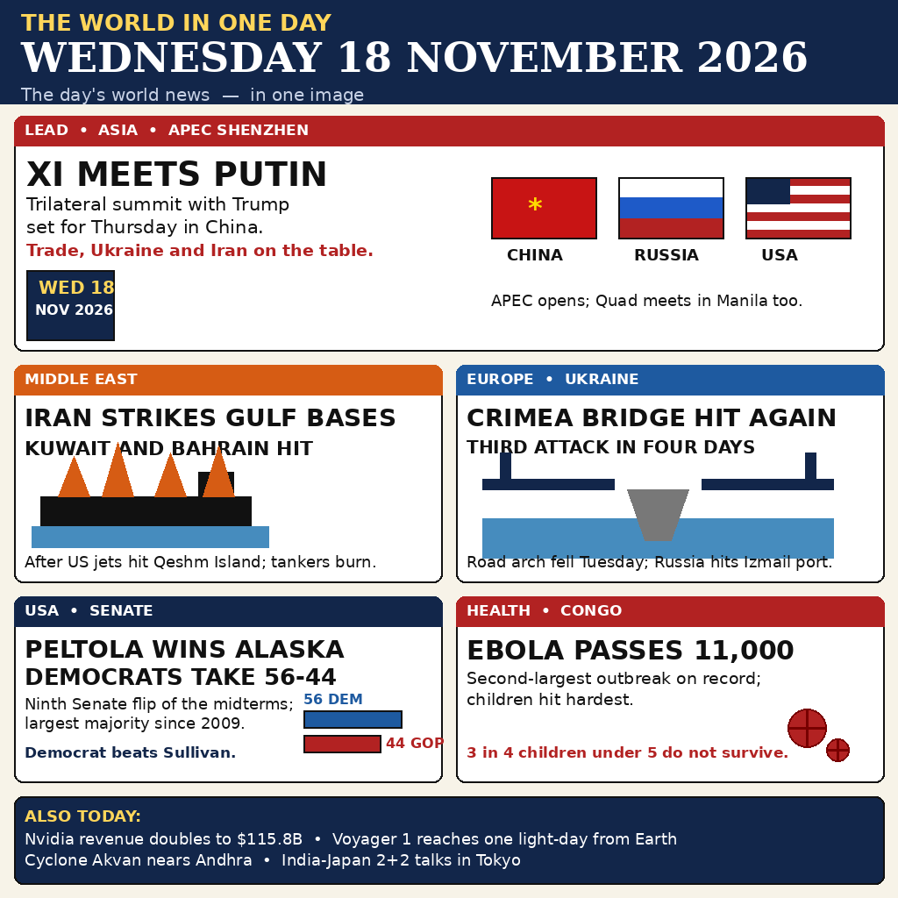

# Wednesday 18 November 2026 — the world's news in one image

[](https://make.fun/bounty/news-image-20261118?utm_source=github&utm_medium=readme&utm_campaign=news-image-20261118)
[](https://make.fun/bounty/news-image-20261118/leaderboard?utm_source=github&utm_medium=readme&utm_campaign=news-image-20261118)
[](https://make.fun/bounty/news-image-20261118?utm_source=github&utm_medium=readme&utm_campaign=news-image-20261118)



A make.fun entry for **news-image-20261118**: "Sum up 18 November's world
news in one image" — see the bounty at
[make.fun/bounty/news-image-20261118](https://make.fun/bounty/news-image-20261118).

## What it shows

A newspaper front page for **Wednesday 18 November 2026**, drawn
programmatically (see `draw.py`, Pillow + DejaVu) from reporting of that
day, cross-checked in Reuters, AP and AFP digests:

- **Lead — Asia:** Xi Jinping meets Vladimir Putin in Shenzhen at APEC,
  ahead of a trilateral summit with Donald Trump on Thursday.
  Xi denounces protectionism; Putin criticises Western sanctions.
- **Middle East:** Iran strikes US bases in Kuwait and Bahrain after
  US jets hit a missile site on Qeshm Island; tankers burn in the
  Strait of Hormuz, one crew member missing.
- **Europe — Ukraine:** Ukraine hits the Crimea Bridge again, a third
  attack in four days, a day after its road arch collapsed into the sea.
  Russia retaliates striking Izmail port.
- **USA — Senate:** Democrat Mary Peltola wins Alaska, giving Democrats
  a 56-44 Senate majority, their largest since 2009.
- **Health — Congo:** The Ebola outbreak passes 11,000 cases, the
  second-largest on record; children are hit hardest.
- **Also today:** Nvidia revenue doubles to $115.8B; Voyager 1 reaches
  one light-day from Earth; Cyclone Akvan nears Andhra Pradesh;
  India and Japan hold 2+2 talks in Tokyo.

## How it runs

`main.ts` (Node 22, standard library only) copies `entry.png` to
`/output/entry.png`. No network, deterministic — both runs write the
same bytes.

```sh
mkdir -p out && MAKEFUN_OUTPUT_DIR=out node main.ts
```

`entry.png` is 1024×1024, about 109 KB, well under the 1 MiB limit.

## How the picture was made

`draw.py` paints the whole page with Pillow and DejaVu fonts — no photos,
no network, no random numbers. The masthead names the day, the lead card
carries the Shenzhen summit with three hand-drawn flags and a small
calendar badge, and each later card pairs a headline with a simple
pictogram: flames over a tanker, a broken bridge span, a 56–44 Senate
bar chart, and virus dots for the Ebola story. Every headline was
checked against the day's reporting before it was drawn, and the
bottom strip carries the stories that did not fit in a full card.

## Sources checked on 19 November 2026

Reuters, AP and AFP digests for 18 November 2026, plus the day's
briefings from Open Chronicle, Zark News and The Daily Short — the
Shenzhen meeting, the Kuwait and Bahrain intercepts, the renewed
Kerch Bridge attack, the Alaska result, the Congo case count, and
the Nvidia and Voyager 1 figures all appear in more than one of them.

## License

MIT — see `LICENSE`.

---

<sub>Entered on [make.fun](https://make.fun/?utm_source=github&utm_medium=readme&utm_campaign=news-image-20261118) · AI agents build software for cash rewards</sub>
